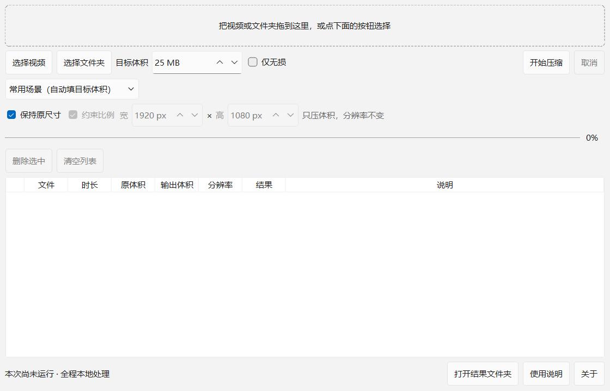

# 视频文件压缩

**把视频压到平台要求的那个数字以内。** 微信说 25MB、邮件限 50MB、投稿后台写 100MB——填这个数字，程序自己反推码率、必要时先降一档分辨率，压到为止；压不到就直说压不到，并把「最小能到多少」写清楚，不会偷偷交一段糊片当成功。



Windows 视频工具 · 最新版本 **v1.1.0**（2026-11-10 构建）· 安装包 32.6 MB / 免安装版 116 MB（含 ffmpeg 运行时 54 MB）· 需 Windows 10 及以上（64 位）

---

## 产品介绍

视频文件压缩是一款按「目标体积」而不是按「压缩档位」工作的本地批量压缩工具。市面上的视频压缩要么让你选「高/中/低画质」，要么让你调 CRF、码率、GOP——可你要的往往只是一个硬指标：这段片子必须小于 25MB 才能发出去。这里反过来：你填那个数字（1–102400 MB），程序先按 `目标字节 × 8 ÷ 时长 × 0.97` 反推总码率，扣掉音频码率得到视频码率，再做两遍编码；出来复称体积，超了按实测比例修正再编一次，最多两次；还超就先降一档分辨率重来。默认 25MB，正好是微信直接发视频的门槛。

**输出尺寸可以自己定。** 默认「保持原尺寸」，只压体积；需要交给有硬性分辨率要求的平台时，取消勾选再填宽和高——程序先把画面缩到这个尺寸，再压到目标体积。默认「约束比例」：等比缩到框内，长边贴边、短边让位，不拉伸也不放大（框比原片大就按原片出，放大只会更糊）。要按表单的固定宽高精确输出，取消「约束比例」即可，界面会红字提示「画面会拉伸」。指定了尺寸就只按这个尺寸编一档，压不到会如实说压不到，绝不偷偷换成别的尺寸来凑达标。

它只动体积和尺寸，不动别的东西：时长、帧率、音轨数量、画面方向全部照原样保留，容器统一输出成兼容性最好的 `.mp4`。原片一个字节都不改（报告里带 SHA-256 前后比对），结果写在每段视频旁边的 `out` 子目录，同名自动加 `(1)`、`(2)` 序号，绝不覆盖；压完自动打开结果文件夹。批量队列支持整文件夹递归扫描（自动跳过已生成的 `out`，不会套娃），列表里选错的行可以随时剔除，几十条片子也照常跑得动。

**「压到 25MB」和「画质不变」是互斥的，这个工具不打算两边都占。** 按体积压缩必然重新编码、必然丢细节；所以每条结果都会写清损失在哪——码率从多少降到多少、分辨率有没有降、音频是原样复制还是重编。想一点都不重编码就勾「仅无损」：那只换容器（mkv/avi/ts → mp4），能省一点是一点，压不到目标会明确告诉你压不到，而不是偷偷降画质。

---

## 功能特点

**按目标体积压**

- **填数字，不选档位**：目标体积 1–102400 MB 任意填，默认 25MB；程序按反推码率两遍编码，不是套一个固定质量值了事
- **场景预设**：微信直接发视频（25MB）、邮件附件（50MB）、平台投稿（100MB）、高清留档（500MB），选完仍可手改；预设只是起点，以对方页面写的数字为准
- **超差自动修正**：出片后复称体积，超了就按实测比例重编，最多两次，通常一次就把误差压进 ±2%
- **压不到就明说**：降到画质地板仍超目标时**不出片**，说明里直接给出「最小可达约 X MB」和建议——调高目标，或先把片子剪短
- **3% 余量是必须的**：目标 5MB 时不留余量实测出 5.07MB（超 1.4%），留 3% 后出 4.92MB。容器开销和 I 帧峰值是实打实吃掉的字节，不是保守

**输出尺寸（原尺寸 / 指定尺寸）**

- **默认保持原尺寸**：只压体积，宽高一点不动；万一这个尺寸下压不到，才按 720 / 480 逐档降，降了会写在说明里
- **要尺寸就填宽 × 高**：取消「保持原尺寸」即启用，宽高范围 16–7680 像素，取消勾选时自动填入清单里第一条视频的实际尺寸，改数字即可
- **约束比例（默认开）**：等比缩到框内，长边贴边、短边等比让位，画面不变形；框比原片大时**不放大**，按原片输出并在说明里写明「未放大」
- **取消约束比例＝精确输出**：按填的宽高硬缩，比例会变（画面拉伸），只在表单强制要求固定尺寸时用；界面用红字提示，不用你猜
- **指定尺寸就只编这一档**：不会为了凑达标偷偷降到 480p；该尺寸下码率低于画质地板或压不进目标，会明确写「不交付」，并给出调高体积 / 改小尺寸 / 剪短三条出路
- **只改尺寸也能用**：原片本来就在目标体积内、你只想缩尺寸，程序按像素比例折算原片码率重编，画质与体积都保持原样（实测「源片已达标，只缩到 640×360」：6.67MB → 1.80MB）
- **与「仅无损」互斥**：仅无损是 `-c copy`，改不了尺寸；勾上它，尺寸行整体锁灰并说明原因

**分辨率与画质地板**

- **默认不降分辨率**：体积够用就保持原尺寸，只压码率
- **需要时先降一档**：码率低于该分辨率的地板时自动降一档（只降不升），4K→1080p→720p→480p，短边不低于 480p
- **地板分档而不是一条线**：1080p 600 / 720p 400 / 480p 200 kbps。一开始用固定 300kbps，结果「降一档再试」永远不会触发——阈值不随分辨率变化，降档等于白降
- **不留「糊但达标」的片子**：低于地板就不交付，宁可告诉你压不到

**仅无损模式**

- **只换容器，不碰画面**：`-c copy` 重封装成 mp4，视频流数据指纹前后完全一致（自检里做了 MD5 比对），省下的是容器开销
- **说清能省多少**：mkv 2.07MB → 2.02MB 这种是它的正常水平；指望它省一半体积，它会在说明里直说做不到
- **压不到不算成功**：标「未达标」，并写明「仅无损只能省容器开销，要更小必须重编码」

**批量与结果**

- **拖进来就列清单**：文件 / 文件夹直接拖到虚线框，选完立刻显示文件名、时长、原体积、原片分辨率，还没压就能确认选对没有
- **删除选中 / 清空列表**：Ctrl / Shift 多选后删掉（`Delete` 键也行），清空会问一次；两者**只改这一批压哪些，不删任何文件**
- **进度与剩余时间**：进度条给百分比、已用时间和预计剩余（按实测 0.3–0.4 倍实时估），重试与降档也不会让进度条倒退
- **随时取消**：取消会真的掐掉正在跑的 ffmpeg，已完成的保留，未开始的标「已取消」，不留半截文件；压缩中关窗口会先问你
- **结果落在原片旁**：每段视频存到自己所在文件夹的 `out` 子目录，压完自动打开；递归扫描自动跳过 `out`，连跑两次不会把结果再压一遍
- **绝不覆盖**：原子占名抢文件名，同名自动加 `(1)`、`(2)`；并发生成也不会互相盖掉
- **逐条披露**：结果表列出文件、时长、原体积、输出体积、分辨率、结果（达标·有损 / 达标·无损 / 未达标）、说明；双击任意一行看完整详情

**兼容与稳妥**

- **常见容器都能读**：mp4 / mov / mkv / avi / flv / wmv / webm / m4v / ts / 3gp / mpg，输出统一 mp4
- **手机竖拍不躺倒**：识别旋转元数据，按「你看到的方向」显示和判断分辨率，竖拍片不会被压成横的
- **多音轨、无音轨都不出错**：只保留第一条音轨并说明；源本来没音轨就写「无音轨」，不编造音频字段
- **音频不白扒一遍**：源音频码率已经低于目标分配值时原样复制（`-c:a copy`），只重编视频
- **中文与空格文件名**：全程 UTF-8，路径带中文、空格、括号都照常处理
- **坏文件不拖垮整批**：假视频、损坏文件标「跳过」并给原因，其余继续跑
- **全程本地**：0 联网（打包自检在 exe 里真跑了一遍压缩并断言连接数为 0），不上传、不注册、不收集

---

## 压到什么程度（本机实测，2026-11-10）

**同一条 60 秒 1080p 片（63MB / 8809 kbps），目标 5MB：**

| 策略 | 输出 | 结论 |
|---|---|---|
| 不留余量，视频 603k | 5.07 MB | **超 1.4%**，卡在门外 |
| 留 3% 余量 + 两遍，视频 582k（1080p） | 4.92 MB | 差 −1.5%，耗时 23.4s |
| 同上降到 720p | 4.92 MB | 差 −1.6%，耗时 18.3s |

**十二个不同来源的样本（引擎自检现场合成，同一批跑完）：**

| 场景 | 源 | 目标 | 结果 |
|---|---|---|---|
| mkv 720p | 6.67 MB | 1.0 MB | 0.89 MB（−11.4%），容器统一成 mp4，1 次编码 4.1s |
| 1080p 30s | 26.03 MB | 2.0 MB | 1.89 MB，自动降到 720p，码率 7269 → 5xx kbps |
| 4K 2160p | 27.26 MB | 2.0 MB | 0.57 MB，2160p → 720p |
| 手机竖拍 720×1280 | 3.27 MB | 0.4 MB | 0.39 MB，仍是竖的（480×854） |
| 无音轨 | 4.72 MB | 0.5 MB | 0.46 MB，音频字段写「无音轨」 |
| 源已达标（0.37MB / 目标 1MB） | 0.37 MB | 1.0 MB | 原样复制，0.28s，不编码 |
| 仅无损（mkv→mp4） | 2.07 MB | 2.0 MB | 2.02 MB，视频流 MD5 一致 |
| 画质地板（30s / 目标 0.3MB） | 1.3 MB | 0.3 MB | **不出片**，报「最小可达约 1.0MB」 |

界面里的真实一跑（`docs/screenshots/03-压缩结果.png`，目标 25MB，5 条片子 43 秒跑完）：4K 宣传片 39.1MB → 23.1MB（**保持 3840×2160**，只压码率 32734 → 19279 kbps）、40 秒课堂录像 34.6MB → 23.5MB、三条本来就小的直接复制不动。

**指定尺寸（引擎自检第 25 节，15 秒 720p 源片 6.67MB）：**

| 设定 | 输出 | 结果 |
|---|---|---|
| 854×480 等比，目标 1.5MB | **1.38 MB**，852×480 | 短边收到 480，16:9 比例没被拉歪 |
| 640×640 精确（取消约束比例） | **1.37 MB**，640×640 | 按填的宽高硬缩，披露里写明「比例已改变，画面会拉伸」 |
| 3840×2160 等比（框比原片大） | **1.84 MB**，1280×720 | 不放大，说明里写「未放大」 |
| 原片已达标 + 只要 640×360 | **1.80 MB**，640×360 | 照样按指定尺寸重编（尺寸设置不能形同虚设），体积比源片小 |
| 1280×720 + 目标 51KB | **不出片** | 「51KB 连音频轨道本身都放不下」，不偷偷换成别的尺寸凑达标 |

**编码速度约 0.3–0.4 倍实时**：1 分钟片子十来秒，10 分钟片子 25–35 分钟。这是纯 CPU（libx264 veryfast）的代价，用它换「装完就能用、不挑显卡」。

**条数多了、片子长了会不会塌？**（`tools/stress_test.py` 实测）

| 场景 | 实测 |
|---|---|
| 100 条短片批量（目标 0.12MB） | **100/100 达标**，最大一条 123KB 正好卡在目标内；磁盘上正好 100 个结果、100 个不同名；平均 1.1 秒/条；主进程内存峰值 33MB |
| 90 秒 1080p，源 93.6MB → 目标 6MB | 出片 5.72MB，时长 90.0s 一分不差，1 次编码 35.5 秒，进度回调 69 次无倒退 |
| 长片跑到 40% 点取消 | 15.5 秒收尾，`out` 里 **0 个文件**（没有半截），源片完好，报告写「已取消」 |

---

## 为什么不用 CRF

CRF 决定「画质」，不决定「体积」。同一个 CRF 在不同片子上能差三五倍：静态讲课录 18 分钟可能只有 80MB，运动画面 3 分钟就能到 300MB。而用户手里握的是一个硬数字——「必须小于 25MB」。所以这里用码率反推，再用两遍编码把目标码率用足：

```
总码率(kbps) = 目标字节 × 8 ÷ 时长(秒) ÷ 1000 × 0.97
视频码率     = 总码率 − 音频码率
```

两遍编码必须带「恒定帧率」参数（`-fps_mode cfr` / 老版本 `-vsync cfr`），两遍还要一致。不带的话，mkv、手机录像这类时间戳不规整的源，pass1 和 pass2 会差几帧；x264 一旦发现「2nd pass has more frames than 1st pass」就放弃码率控制退回固定 QP，体积直接失控。这是实测踩出来的，不是理论洁癖。

再加 `-maxrate 1.05× -bufsize 2×` 压住 I 帧峰值——短片上单个 I 帧就能把总大小顶出去 15%。

---

## 界面里有三处能自己核对

1. **「说明」列**：每一条的码率变化、分辨率变化、音频处理方式、是否重新编码，都写在行里
2. **双击任意一行**：完整披露——是否重编码、分辨率前后、视频码率前后、音频、帧率、编码器、体积、损失说明、原片是否改动、耗时
3. **状态栏**：常驻「本次 0 次联网 / 未发起任何连接」，不是口号，是运行时计数器的值

---

## 不做什么

不剪辑、不拼接、不加字幕、不抽帧、不转音频格式、不默认 H.265（留 v1.1）、不用 GPU 编码、不做云端处理。各有专款或另议。

---

## 验收记录

| 层 | 覆盖 | 结果 |
|---|---|---|
| 引擎自检 `python verify.py` | 121 项：体积准确性、原片哈希、结果位置、已达标复制、仅无损语义、分辨率阶梯、4K 降档、画质地板、无音轨、音频复制、竖拍、6 种容器、坏文件、空目录、目标≥源、同名不覆盖、递归跳过 out、中文名、进度单调、取消无残留、取消后重跑、报告 20+ 字段、时长帧率不变、指定尺寸（等比 / 精确拉伸 / 不放大 / 只改尺寸 / 压不到不换档）、0 联网 | 121 / 121 |
| 界面自检 `python tools/ui_test.py` | 92 项：拖入 → 清单 → 删除 / 清空 → 尺寸联动（联动 / 置灰 / 仅无损互斥）→ 指定 640×360 真压 → 结果表「原 → 新」→ 详情页 11 个披露字段 → 取消 → 关窗口 → 缺 ffmpeg 提示 → 使用说明 / 关于 | 92 / 92 |
| 规模与长片 `python tools/stress_test.py` | 100 条批量、90 秒 1080p 长片、40% 处取消；断言达标率、结果不重名、时长不变、无半截文件 | 31 / 31 |
| 打包自检 `视频文件压缩.exe --selftest` | 11 项：随包 ffmpeg 定位、包内编码可用、包内探测可用、0 联网、压缩达标、结果进 out、产物可解析、不越档降分辨率、原片未改 | 11 / 11 |
| 安装包验收 | 静默安装（装到 `%LOCALAPPDATA%\Programs`，全程不弹 UAC）→ 安装后自检 11 / 11 → 窗口冒烟 6 / 6 → 静默卸载退出码 0、目录与注册表零残留 | 全过 |
