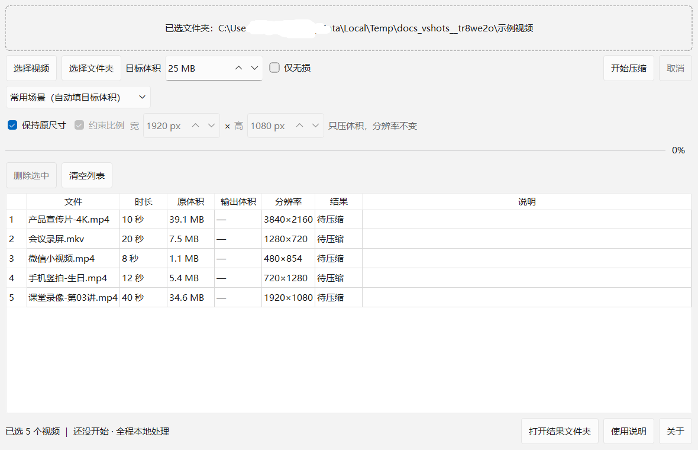
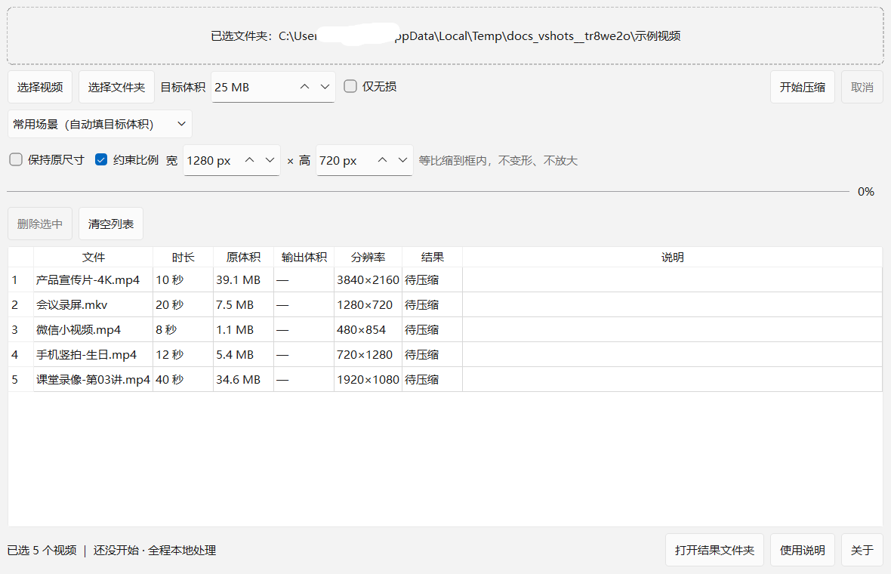
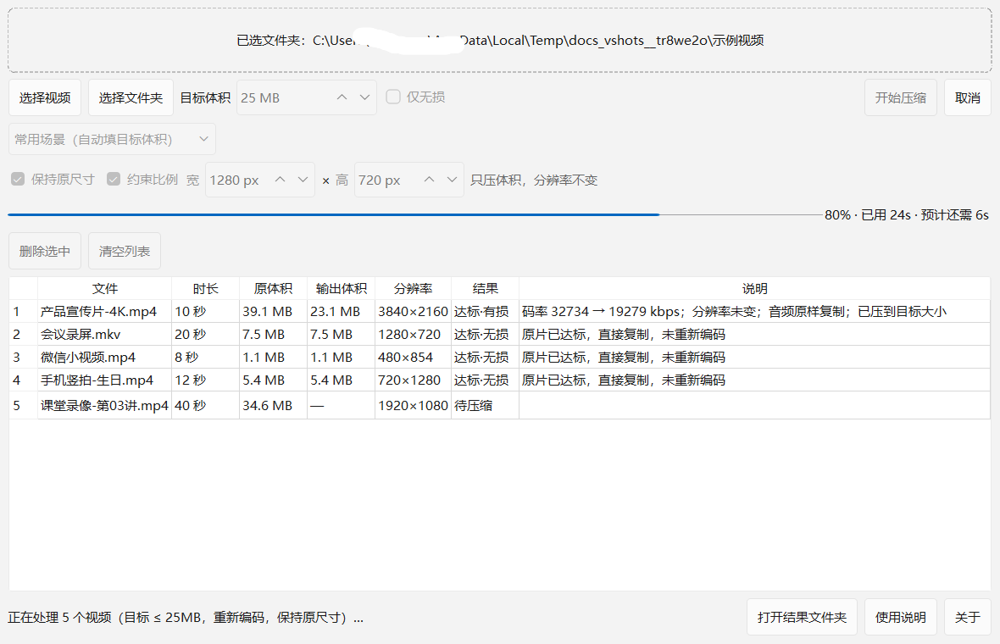
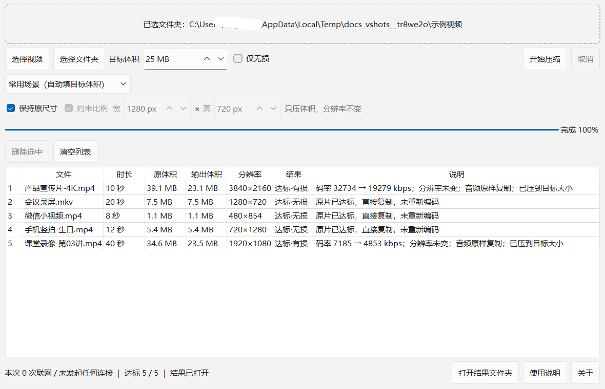
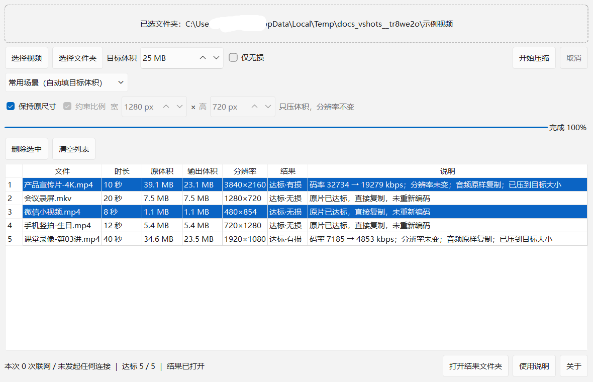
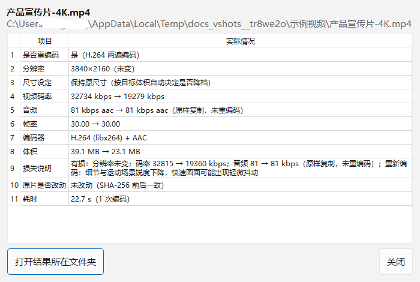
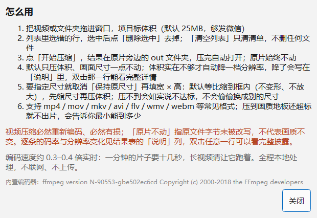

# 视频文件压缩 · 使用教程

这份教程按「你要干什么」组织，七篇都能单独看，不用从头读。第一次用，先看[三步压完一批视频](#三步压完一批视频)；赶时间的话，直接翻到你要的那个场景。

> **先记住一句话**：按指定体积压缩**必然重编码、必然有损**。程序能做的，是在体积硬指标内尽量保住画质——体积够用就不降分辨率，只压码率。每条结果都会写清损失在哪；想一点都不重编码，就勾「仅无损」，它会老实告诉你只能省容器开销。
>
> 要交给有分辨率要求的平台，就取消「保持原尺寸」再填宽高（[教程七](#教程七平台要求固定尺寸原尺寸--指定尺寸)）。不填就是保持原尺寸。
>
> 原片始终不动，结果另存在原片旁边的 `out` 文件夹。

---

## 开始之前

- 已打开软件（窗口标题：`视频文件压缩 · 创炫互动`）；装的是安装包就走开始菜单，免安装版就双击文件夹里的 `视频文件压缩.exe`
- 要处理的视频在**你能找到的位置**：桌面、下载、手机导出的相册文件夹都行，拖进来即可
- 支持的格式：**mp4 / mov / mkv / avi / flv / wmv / webm / m4v / ts / 3gp / mpg**；输出统一是 mp4
- 磁盘上留出空间：结果不覆盖，每条都是新文件，体积大致等于目标体积 × 条数
- 机器上不用另外装 ffmpeg：安装包/免安装版里都带了（`_internal\ffmpeg\bin`）

---

## 三步压完一批视频

### 1. 把视频加进来

把视频或整个文件夹直接拖到窗口顶端那块虚线框里；不想拖就点 **`选择视频`** 或 **`选择文件夹`**（选文件夹会连子文件夹一起找）。



加进来马上就能看到清单：文件名、时长、原体积、原片分辨率，结果列写着「待压缩」。**还没压就能确认选对没有**——几十条里夹着一条不该压的，事先发现比压完再找省事。

时长和分辨率要问 ffprobe，条数多了也就一两秒；没读完的先是「—」，读完自动补上。

### 2. 填目标体积

在「目标体积」输入框里填**平台给的数字**（单位 MB，1–102400，默认 25）。不确定就先选第二排「常用场景」：

| 预设 | 填的数字 | 适合 |
|---|---|---|
| 微信直接发视频 | 25 MB | 微信聊天里直接发视频的门槛 |
| 邮件附件 | 50 MB | 大部分邮箱的单封附件上限 |
| 平台投稿 | 100 MB | B 站 / 视频号等投稿后台常见上限 |
| 高清留档 | 500 MB | 只是压缩一下节省空间，不急着发 |

选完仍可在输入框里手改。**别猜，照抄对方页面写的数字**——同一个平台不同入口的限制都可能不一样。

「仅无损」默认不勾，先不用管，需要时看[教程四](#教程四只想换容器一点都不想重编码仅无损)。

### 3. 要不要改尺寸（默认不改）

**大多数情况不用管**：勾着「保持原尺寸」，程序只压体积，宽高一点不动。

只有在对方平台明确要求分辨率时才动它（比如投稿后台写「仅支持 1920×1080」）：取消「保持原尺寸」，再填宽和高。



- 取消勾选时，宽高会自动填成清单里第一条视频的实际尺寸，你在这个基础上改数字即可
- **「约束比例」默认勾着**：等比缩到「宽 × 高」这个框内，不变形、不放大。填 1280×720，1080p 的变成 1280×720，4K 的也变成 1280×720，竖拍的按短边让位
- **取消「约束比例」＝按你填的宽高精确输出**，比例会变（画面拉伸）；提示文字会变成红字。只在表单强制某个固定尺寸时才这么用
- **框比原片还大？不放大**：按原片尺寸出，说明里写「未放大」——放大不会多出细节，只会更糊更慢
- **与「仅无损」互斥**：仅无损是原样搬画面数据，改尺寸必须重编码；勾上仅无损，尺寸行会自动锁灰并写明「仅无损不改尺寸」

填尺寸再压，结果表的分辨率列会写成「原 → 新」，例如 `1920×1080 → 1280×720`。

### 4. 点「开始压缩」



进度条上写「80% · 已用 21s · 预计还需 5s」，状态栏写明这一批怎么压——保持原尺寸时是「正在处理 5 个视频（目标 ≤ 25MB，重新编码，保持原尺寸）…」，指定了尺寸则是「缩到 1280×720（等比，不变形）」。每压完一条，那一行立刻变成结果（输出体积、结果、说明），没轮到的仍是「待压缩」。速度约 **0.3–0.4 倍实时**（1 分钟片子十来秒，10 分钟片子 25–35 分钟），所以长片子请让它跑着，别频繁切窗口。

跑完后表格变成结果表，状态栏写「达标 X / X」并自动打开结果文件夹：



---

## 教程一：发微信，压到 25MB 以内

### 操作步骤

1. 拖入视频（或多条）
2. 「目标体积」保持默认 **25**，或选常用场景「微信直接发视频（约 25MB）」
3. 点「开始压缩」，等状态栏出现「达标 N / N」
4. 结果在 `out` 文件夹里，直接把那个 mp4 拖进微信发出去

### 如果显示「未达标」

说明里会写「压到画质地板（短边 480p、200kbps）仍有约 X MB，超过目标 Y MB，不交付比这更糊的结果」。三种处理：

| 情况 | 怎么办 |
|---|---|
| 片子太长（比如 40 分钟会议录像要压到 25MB） | 先剪短，或把目标调到说明里给的那个「最小可达」以上 |
| 目标填得太狠（几百 MB 的片子要 1MB） | 把目标调高到合理值 |
| 源片本身已经是压过的低码率 | 它已经接近地板，压不出更多空间，接受原样发送或用剪辑软件重新导出 |

**它不会给你一段满屏色块却标「达标」的视频**——不交付比糊片更诚实。

---

## 教程二：邮件附件 50MB / 投稿 100MB

1. 选「常用场景」里对应的一项（邮件 50MB / 平台投稿 100MB），或直接填数字
2. 加进来压完即可

100MB 以内基本不会触发降分辨率：1080p 长片在这个体积下码率够用，画面尺寸原样保留。**只有码率低于该分辨率的地板才会降档**，而且降了会写在「说明」列里：

```
有损：分辨率 1920×1080 → 1280×720（重采样，细节按比例减少）；码率 7269 → 512 kbps；音频 128 → 96 kbps
```

---

## 教程三：整个文件夹批量，先剔掉不想压的

### 操作步骤

1. 点 **`选择文件夹`** 或把文件夹拖进来，程序会递归扫描子文件夹（自动跳过已有的 `out`，不会把上次结果再压一遍）
2. 清单里核对一下：时长空的说明读不出来（会标「跳过」并给原因）
3. 选错的行，用 Ctrl / Shift 多选后点 **`删除选中`**（或按 `Delete` 键）
4. 想重来就点 **`清空列表`**，会问你一次



> `删除选中` 和 `清空列表` **只改这一批压哪些，不动磁盘上的任何文件**。删错了重新拖进来就行。

5. 填目标体积 → 点「开始压缩」

### 常见问题

- **多条交叉压缩？** 不并发，一条一条来。视频编码吃满 CPU，并发只会让每条都变慢、难以估时
- **结果散落在各处？** 每条结果存在**它自己所在文件夹**的 `out` 里，不是集中到一个地方。状态栏的「打开结果文件夹」只打开结果最多的那个，其余仍在原处
- **跑到一半想停？** 点「取消」，正在编的那条会被掐掉（不留半截文件），已完成的保留

---

## 教程四：只想换容器，一点都不想重编码（仅无损）

勾上「仅无损」后，程序只做 `-c copy`：把视频流原样搬进 mp4 容器，画面一个字节都不重编。

### 操作步骤

1. 勾 **`仅无损`**
2. 填目标体积（想验证能不能达标，就填比原文件小的值）
3. 点「开始压缩」

### 能得到什么

| 源 | 目标 | 结果 |
|---|---|---|
| mkv 2.07 MB | 2.0 MB | 2.02 MB，达标，视频流 MD5 前后一致 |
| mkv 6.67 MB | 0.5 MB | **不出片**，说明写「仅无损只能省容器开销：换容器后仍 6.7MB，超过目标 0.5MB。要更小必须重编码，请取消「仅无损」」 |

能省的是容器开销（mkv/avi/ts 的索引与封装冗余），通常是几个百分点。**想要真正变小，必须重编码**，这是格式本身的限制，不是工具不给力。

---

## 教程五：压不到目标怎么办

先看「说明」列到底说了什么，按下面这张表对：

| 说明里出现 | 含义 | 处理 |
|---|---|---|
| 压到画质地板……仍有约 X MB | 已经降到 480p、200kbps 的下限，再压就是满屏色块 | 把目标调到 X MB 以上，或先剪短再压 |
| 码率偏低，静态内容没问题，快速运动画面会偏软 | 达标了，但码率确实低 | 能用；介意就把目标调高一点重压 |
| 分辨率 1920×1080 → 1280×720 | 触发降档了 | 正常行为；不想降就把目标调高 |
| 原片已达标，直接复制，未重新编码 | 源文件本来就比目标小 | 什么都没做，省了一次无意义的编码 |
| 读不出视频信息（可能已损坏…） | 假视频、损坏文件、或不是视频 | 换文件；这条被跳过，不影响其余 |
| 已取消 | 你点了取消 | 重新开始即可，无残留 |

---

## 教程六：4K 大文件 / 竖拍手机视频

- **4K（3840×2160）压到 25MB**：默认先保 4K、只压码率；如果码率低于 1080p 地板就自动降档。实测 39.1MB 的 4K 宣传片压到 23.3MB 时**保持了 3840×2160**（19.5s）；27MB 的 4K 片压到 2MB 时降到 1280×720
- **手机竖拍（720×1280）**：识别旋转元数据，按你看到的方向判断。实测 5.4MB 竖拍片压到 0.39MB 后仍是竖的（480×854）
- **无音轨的录屏**：音频字段写「无音轨」，不编造数字
- **双音轨**：只保留第一条，并在说明里写清

---

## 教程七：平台要求固定尺寸（原尺寸 / 指定尺寸）

**场景**：投稿后台写「画面需为 1920×1080」，课程平台写「1280×720 横屏」，或者某个表单强制某个宽高——体积反而不是问题，尺寸才是。

### 操作步骤

1. 拖入视频，填平台要求的体积上限（没有体积要求就填个宽松值，比如 500）
2. 取消勾 **`保持原尺寸`**
3. **`约束比例` 保持勾选**，宽填 1920（高会按第一条视频的比例自动算出 1080）；要竖屏成品就宽填 1080
4. 点「开始压缩」
5. 结果表核对「分辨率」列，应显示 `3840×2160 → 1920×1080` 这样的「原 → 新」

### 会发生什么

- **缩尺寸本身就会让体积变小**（像素少了一半以上），所以通常轻松达标；这一批里体积本来就小的片子，也会按你的尺寸重编一遍，不会因为「已经达标」就跳过尺寸设置
- 平台要的是精确宽高、不在乎比例（比如某些系统的头像视频 1080×1080）：取消「约束比例」再压，提示变红字「画面会拉伸」，输出就是 1080×1080
- **指定了尺寸就只按这一档编**：哪怕这个尺寸下要压到目标体积只能给很低码率、低于画质地板，也不会偷偷降到 480p 来凑达标；说明里会写「在指定尺寸 1920×1080 下…不交付」，并给出三条出路：调高目标体积、把尺寸改小、先把视频剪短
- 想要更小的文件又不在意尺寸，就不要填尺寸——让程序自己按目标体积决定降不降档，它比你手填更会算

---

## 结果在哪、怎么看详情

- 结果统一是 `.mp4`，存在原片旁的 `out` 子目录；同名自动变成 `xxx (1).mp4`、`xxx (2).mp4`，**绝不覆盖**
- 压完自动打开结果文件夹；也可以点右下角 **`打开结果文件夹`**
- **双击任意一行**看完整详情：



详情里十一项都在：是否重编码、分辨率前后、尺寸设定（这次是保持原尺寸还是指定了哪一档）、视频码率前后、音频、帧率、编码器、体积、损失说明、原片是否改动（SHA-256 前后一致）、耗时。这些不是文案，是这条片子跑完当时的实测值。

---

## 取消与关闭

- **取消**：掐掉正在编码的那条 ffmpeg，已完成的结果保留，剩下的不再处理。取消后那条标「已取消」，不留半截文件，可以直接重跑
- **压缩中关窗口**：会先问你「还有视频正在编码。停止并退出吗？」——选「是」就停下退出，选「否」继续跑
- 关窗口时如果后台还在收尾，会提示你等几秒，避免留下半截文件

---

## 界面里自带的使用说明

右下角 **`使用说明`** 是同一套口径的简版（五条），**`关于`** 只有身份信息：应用名、版本、公司全称、网址。



---

## 常见问题

| 问题 | 回答 |
|---|---|
| 会改我的原片吗？ | 不会。原片只读，结果写进 `out`；详情里带 SHA-256 前后比对 |
| 要联网吗？ | 不要。状态栏常驻「本次 0 次联网 / 未发起任何连接」，这是运行时计数器的值 |
| 要另外装 ffmpeg 吗？ | 不用，安装包和免安装版都带 |
| 为什么这么慢？ | 纯 CPU 编码（libx264 veryfast），约 0.3–0.4 倍实时。用它换「装完就能用、不挑显卡」 |
| 能让它更快吗？ | 目前没有 GPU 加速（画质与兼容性差异大，另议）；缩短片长比调参更有效 |
| 压完为什么画质变差了？ | 按体积压缩必然丢细节，程度取决于目标有多狠；「说明」和详情里写了码率降了多少 |
| 输出的文件为什么会变大？ | 不会。源已达标时原样复制；重编码时按目标反推码率并复称体积，超差会重编修正 |
| 支持 H.265 吗？ | 本版不做（兼容性与解码开销大），后续版本再评估 |
| 能改分辨率吗？ | 能。取消「保持原尺寸」再填宽 × 高，默认等比缩到框内、不放大；要精确拉伸就取消「约束比例」 |
| 填了 1920×1080 却提示未达标？ | 这个尺寸下要压到目标体积只能给很低的码率，低于画质地板，宁可不出片；调高目标体积或把尺寸改小 |
| 设了尺寸怎么没生效？ | 先看「保持原尺寸」有没有取消；再确认没勾「仅无损」——它只换容器，改不了尺寸 |
| 能压 mkv / avi / mov 吗？ | 能，输出统一 mp4；mov 的 ProRes 也能读，但会重编成 H.264 |
| 能在压缩时做别的事吗？ | 可以，但会占满 CPU，别的时间估算会变长 |

---

## 进阶技巧

- **长片子先切片再压**：40 分钟录像要压到 25MB，怎么分码率都难看；切成 4 段分别压，观感会明显更好
- **目标别贴着上限填**：平台写「不超过 25MB」，填 24 更稳（平台统计口径可能含元数据）
- **一次填一个目标，不要一档一档试**：想比较效果就复制一份改目标重跑，同名会自动加序号，不覆盖前一次
- **批量前先拿一条试**：几十条长片子，先压一条看「说明」里的码率是否可接受，再决定目标

---

## 命令行用法（不想开界面 / 要写进脚本）

```bash
python cli.py ./相册 --target 25            # 压到 ≤25MB，结果进每段视频旁的 out
python cli.py ./相册 --target 25 --open     # 压完打开结果文件夹
python cli.py a.mp4 b.mov --target 100 --out ./out
python cli.py ./素材 --target 25 --lossless-only    # 仅无损：只换容器
python cli.py ./素材 --target 25 --size 1280x720    # 等比缩到 1280×720 以内再压
python cli.py ./素材 --target 25 --size 1080x1080 --stretch   # 精确 1080×1080，比例会变
python cli.py --version                     # 版本、口径、实际用的 ffmpeg
python verify.py                            # 引擎自检，121 项断言
```

每条结果写进 `report.json`，字段与界面详情页一致。命令行版只依赖 Python 与 ffmpeg，不需要 PySide6。

> 打包后的 exe 也能自己验一遍：`视频文件压缩.exe --selftest 日志.txt`，11 项断言，用来确认这一份包里的 ffmpeg 真的能用。
